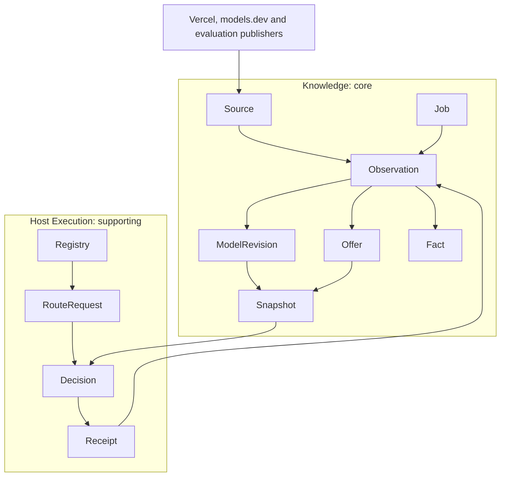
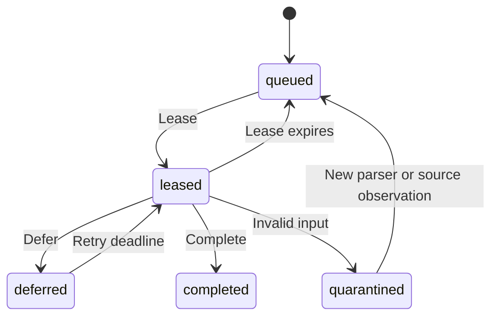
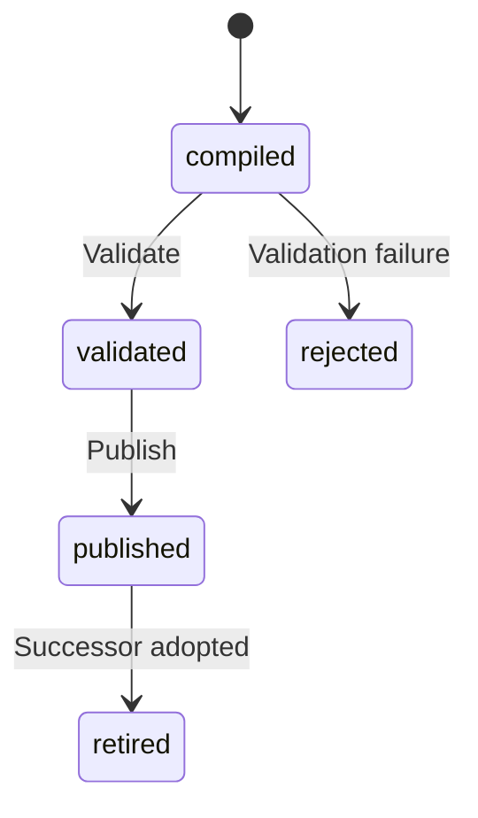
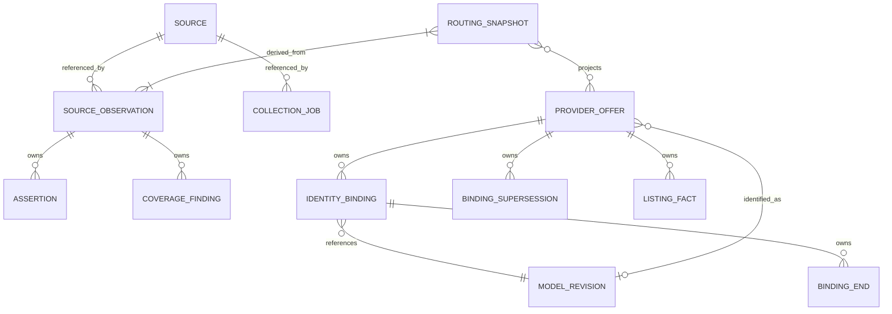
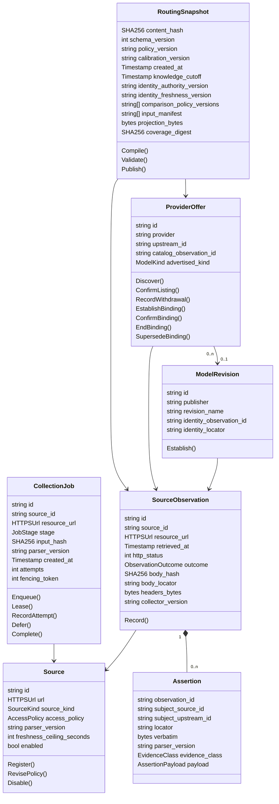

# Routing knowledge model

Draft, pass 1. Boundaries and policy values are proposed unless explicitly requested in `CLAUDE.md`.

## Context map and language

Knowledge is the core context: source observations, model revisions, offers, measured results and immutable routing snapshots. Host Execution is a supporting external context: registry eligibility, account entitlement, task outcomes and resource reservations. “Available” in Knowledge means listed; in Host Execution it means currently executable. Never persist one as the other. Transport/authentication are generic infrastructure, not separate invented domain aggregates.

Vercel, models.dev, evaluation publishers and host receipts enter Knowledge through source-specific anti-corruption adapters. Raw vendor types never leave adapters. Knowledge publishes a versioned snapshot to Host Execution as a customer/supplier contract. Host Execution sends privacy-filtered receipts, not execution identities or credentials. Collection, evidence reconciliation and routing are groupings inside Knowledge, not separate bounded contexts.

Store observations and explicit identity decisions. Derive current availability, accepted prices, benchmark-relative strengths, weaknesses, freshness and rankings. Compiled snapshots deliberately materialize those derivations with input hashes and algorithm versions so they can be reproduced.

## Source

Entity and aggregate root. Fields: `id: string`, `url: validated HTTPS URL`, `source_kind: SourceKind`, `access_policy: AccessPolicy`, `parser_version: string`, `freshness_ceiling_seconds: positive integer` and `enabled: bool`. Owns no observations; observations reference it. References observations 1 to 0..n and jobs 1 to 0..n. `Register`, `RevisePolicy` and `Disable` validate URL allowlisting, positive ceilings and explicit rights. `AccessPolicy` is a value object: `research: Permission`, `extraction: Permission`, `redistribution: Permission`, `terms_url: HTTPS URL`, `license_text: string`, `checked_at: timestamp`, `effective_at: timestamp` and `expires_at: timestamp`. Permission is the enumeration allowed/denied/unknown. Effective time must precede expiry. The newest effective non-expired policy governs each use; conflicting equal-time policies, absence and expiry deny the affected use. Unknown license is the literal `unknown`, not an implied permission. An inaccessible terms URL is still recorded as a URL with explicit failed observation.

Lifecycle: enabled to disabled through `Disable`, disabled to enabled through `RevisePolicy` with an allowed policy. No other transitions. Policy revisions do not modify historical observations.

## CollectionJob

Entity and aggregate root. Fields: `id: string`, `source_id: string`, `resource_url: HTTPS URL`, `stage: JobStage`, `input_hash: SHA-256`, `parser_version: string`, `created_at: timestamp`, `attempts: nonnegative integer` and `fencing_token: nonnegative integer`. References one Source and 0..1 produced Observation. Owns 0..n lease and attempt facts. `Enqueue`, `Lease`, `RecordAttempt`, `Defer` and `Complete` enforce deterministic job identity, increasing fencing tokens and acknowledgement by the active lease only. Lease facts carry `job_id`, `token`, `worker_id`, `leased_at` and `expires_at`; attempt facts carry `job_id`, `token`, `observed_at`, `outcome`, `detail` and `retry_not_before`. No future completion timestamp sits null on the job.

Unlisted transitions are refused. Terminal completion exists as a separate completion fact. Dead-lettered and quarantined work cannot disappear from coverage.

## SourceObservation

Entity and aggregate root. Fields: `id: string`, `source_id: string`, `resource_url: HTTPS URL`, `retrieved_at: timestamp`, `http_status: integer`, `outcome: ObservationOutcome`, `body_hash: SHA-256`, `body_locator: relative path or content-store ID`, `headers_bytes: bytes` and `collector_version: string`. References one Source and one content blob; an empty body has the actual SHA-256 of zero bytes. A `304` owns a reference fact to one prior successful observation instead of pretending it contains a new response body. `Record` enforces content hash/byte fidelity and outcome/status compatibility. Observations are immutable. Owns 0..n Assertions and CoverageFindings. A failure body is evidence of a failure, never a model card.

## Assertion

Immutable value object owned by exactly one observation, 0..n per observation. Common fields: `observation_id: string`, `subject_source_id: string`, `subject_upstream_id: string`, `locator: string`, `verbatim: bytes`, `parser_version: string`, `evidence_class: catalog_claim|provider_reported|independent|host_observed` and `payload: AssertionPayload`. Constructor validates source-locator bounds and exact numeric spans. Facts can reference 0..1 resolved ModelRevision or Offer through an identity-resolution fact; unresolved subjects stay unresolved.

`AssertionPayload` is a closed sum, not an EAV bag:

- `Capability`, `ImageFormat`, `ImageSemantic`, `ImageRequirement` and `Limit`: complete immutable fields, ownership, legal combinations and constructors are defined in [image capability contract](image-capabilities.md#facts-and-admission). Limit scope may be input, output or combined; image role is separate.
- `Claim`: `dimension: task dimension enum`, `polarity: strength|weakness|operational_limit`, `text: string`. Claim text never becomes measured quality without a measurement.
- `Measurement`: the complete raw, possibly unresolved value object and SourceRun/metadata/sample children are defined in [benchmark comparability](benchmark-comparability.md#evidence-objects). Exact revision is a separately evidenced fact, not required for raw storage. Comparison and calibrated quality are separate derived classifications.
- `PriceComponent`: `offer_id: string`, `currency: ISO code`, `amount: nonnegative exact decimal`, `unit: token|million_tokens|image|megapixel|second|character|request`, `category: price category enum`, `quote_knowledge: exact|proven_upper_bound|incomplete` and `scope: PriceScope`. Scope contains direction, underlying provider, region, service tier, context band boundary semantics, cache retention, image operation, dimensions, image count, quality, style and steps. Not-applicable is a distinct case from unknown. Proven upper bounds require an evidence child recording covered component/range predicates; unknown applicable components invalidate the bound.

Payload variants have separate relational child tables. Assertions never mutate; retractions are separate facts referencing them. A source-local duplicate is rejected by observation/subject/locator/payload fingerprint identity.

## ModelRevision

Entity and aggregate root. Fields: `id: string`, `publisher: string`, `revision_name: string`, `identity_observation_id: string` and `identity_locator: string`. `Establish` requires evidence for the exact revision. References one identity observation and 0..n Offers, plus 0..n assertions by ID. Does not own a second alias timeline. Source-scoped aliases are ProviderOffers whose binding facts reference this revision. Identity is the exact source-evidenced publisher revision including date/variant/configuration where distinguished, not a display-name uniqueness guess. Mutable aliases do not rename the revision. Binding changes cannot transfer benchmark evidence between revisions. Immutable revision identity has no changing lifecycle.

## ProviderOffer

Entity and aggregate root. Fields: `id: string`, `provider: string`, `upstream_id: string`, `catalog_observation_id: string` and `advertised_kind: ModelKind`. `Discover` requires an actual source entry. References one catalog observation, 0..1 proven ModelRevision through an identity fact and 0..n offer-scoped assertions. Owns 0..n listing and withdrawal facts with observation/time, plus Binding/BindingEnd/BindingSupersession/Confirmation facts with complete fields and relationships in [temporal identity](model-identity.md#facts-ownership-and-time). EstablishBinding, ConfirmBinding, EndBinding and SupersedeBinding preserve those invariants through IdentityResolution. No account credentials are stored. `ConfirmListing` and `RecordWithdrawal` retain history. Listed to withdrawn on confirmed removal; withdrawn to listed on a fresh listing. A single schema-broken fetch cannot withdraw an offer. More than one supported live binding to distinct revisions marks identity ambiguous and forbids revision-derived assertions in snapshots. Offer-scoped assertions can remain usable for explicit unknown-quality fallback. Account eligibility is outside this aggregate.

## RoutingSnapshot

Entity and aggregate root. Fields: `content_hash: SHA-256`, `schema_version: positive integer`, `policy_version: string`, `calibration_version: string`, `created_at: timestamp`, `knowledge_cutoff: timestamp`, `identity_authority_version: string`, `identity_freshness_version: string`, `comparison_policy_versions: ordered string list`, `input_manifest: ordered source observation IDs`, `projection_bytes: bytes` and `coverage_digest: SHA-256`. Owns its immutable manifest, validation and publication facts. References 1..n observations and 0..n offers/revisions. `Compile`, `Validate` and `Publish` enforce referential closure, rights filtering, supported schema, deterministic hashes and all validation gates. Publication is forbidden without validation of the same content hash. Retractions of contributing evidence cause a successor snapshot, never mutation of an existing one.

Unlisted transitions are refused. `Retire(successor_hash, publication_id)` records the later retirement fact after a successor publication-channel event; the artifact bytes stay immutable. Client adoption and rollback are local host facts, not mutation of the published artifact.

## RouteRequest, RoutingDecision and HostReceipt

Value objects. `RouteRequest` fields, behaviors and invariants are defined completely in [router contract](router.md#request); it references one runtime registry generation and one compatible snapshot generation. `RoutingDecision` fields: `request_id`, `selected: Selection|NoSelection`, `alternatives: ordered Selection list`, `rejections: ordered offer/reason list`, `warnings: ordered reason list`, `snapshot_hash`, `policy_version` and `runtime_generation`. `Selection` contains `offer_id`, `model_revision: known ID|unknown`, `configuration`, `price: bounded estimate|incomplete`, `quality: calibrated bound|uncalibrated`, `latency: estimate|unknown`, `evidence_ids` and `relaxations`. Constructors preserve hard constraints and stable ordering. Ranking is the `Route` domain service because it compares several offers against one request.

`HostReceipt` fields: `receipt_id`, `request_id`, `offer_id`, `revision_identity`, `configuration`, `task_family`, `started_at`, `duration_ms`, `outcome`, `validator_version`, `usage_components`, `cost_status` and `evidence_tier`. Each usage component has `category`, `direction`, `image_role: request|input_image|output_image|reference|mask`, `knowledge: known|unknown` and `quantity_bounds: exact or bounded decimal values|unknown`; categories are text tokens, image tokens, pixels, image bytes, megapixels, image count, steps, search requests and seconds. Exact receipt variants represent completed, failed and cancelled attempts without holes or fake zero usage. `Record` enforces outcome provenance and excludes prompt/tool/image content. References one host decision correlation and one offer; no execution aggregate is invented inside Knowledge.

## CoverageFinding and StageOutputLink

Immutable value objects owned by SourceObservation. CoverageFinding fields: `subject_upstream_id: string`, `channel: closed inventory channel`, `outcome: researched|empty|blocked|identity_ambiguous|unresearched|invalid` and `detail: string`. One observation has 0..n findings, unique per subject/channel. StageOutputLink fields: `job_id: string`, `work_input_hash: SHA-256`, `output_id: string` and `recorded_at: timestamp`; one observation has 0..n links referencing jobs, each link created with its observation outbox event. Its consumer completes only the exact work tuple under a current lease. Lease expiry and quarantine re-entry are infrastructure reconciliation operations on CollectionJob with durable attempt/lease facts, not silent state resets.

## Enumerations

`SourceKind`: catalog API, provider documentation, evaluation registry, model card or host receipt. `JobStage`: fetch, parse, resolve, validate or compile. `ObservationOutcome`: retrieved, unchanged, blocked, not found, deferred or invalid. `ModelKind`: language, image, embedding, reranking, audio, video, evaluation or unknown. Task dimensions and operation variants are the closed sets in the router request. New values require schema-versioned readers, not silently ignored strings.

## Relationships and structure

Authoritative delegated contracts: image assertions use the typed variants and tables in [image-capabilities](image-capabilities.md), including separate format, alpha, reference, mask and output facts. Benchmark measurements use the raw unresolved shape and normalized children in [benchmark-comparability](benchmark-comparability.md). Identity uses append-only `ProviderOffer`-owned facts and the named `IdentityResolution` service in [model-identity](model-identity.md). The object sections above delegate to those canonical definitions; no alternate legacy payload is active.

Open: exact source inventory and redistribution rights; calibration dataset and success validators; policy defaults; signed remote distribution; operational ownership. No schema or inference implementation begins before the corresponding contracts are accepted.
