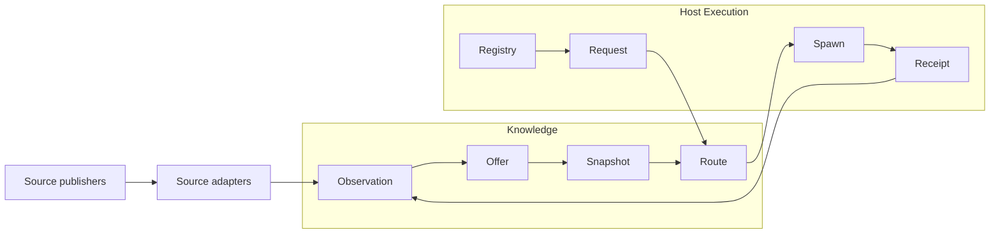
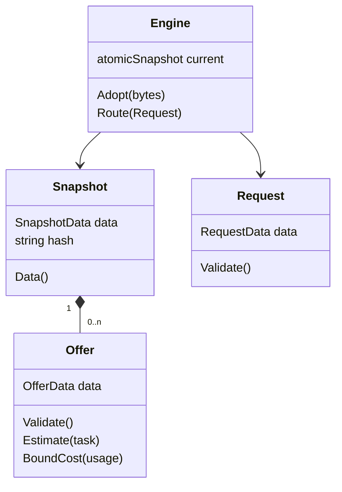

# Educated routing contract

Version 1. Normative for this delivery under ADR 0003. Replaces the production routing surface in `router.md` and the routing fields of the earlier proposed domain model. Research export contracts remain unchanged. Contracts must pass independent review before implementation.

## Context and ownership

Knowledge is the core context. Source owns access policy. SourceObservation owns raw bytes and immutable parsed assertions. ProviderOffer owns advertised facts and revision associations. RoutingSnapshot owns its immutable projection. Host Execution is the supporting context and owns credentials, the live eligible registry, spawning, cancellation, retries, devices and task validators. Listed is not executable. Vendor representations stay in source/host adapters. Route is a pure domain service, not an Agent aggregate.

Snapshot is an immutable value projection of the RoutingSnapshot aggregate. Request, Offer, Signal, Price, Limit and internal estimates are value objects. Public Decision, Selection, Rejection, Estimate and CostEstimate are detached boundary DTOs with exported fields; caller mutation cannot affect protected domain state or another returned result. Enumerations below are closed. Constructors validate all fields and copy slices; returned views also copy. Domain objects expose no mutable fields. IDs remain strings. Exported Data structs are boundary DTOs, not valid domain objects until constructed. Each DTO field uses the snake-case JSON form of its Go name. Canonical bytes use the Apache-2.0 `github.com/cyberphone/json-canonicalization/go/src/webpki.org/jsoncanonicalizer` dependency, pinned through Go modules, not a new serializer. All DTO integers must fit -9007199254740991..9007199254740991 before encoding. Time values must be UTC, millisecond-aligned and have years 1..9999. Canonical serialization uses `2006-01-02T15:04:05.000Z`, including `.000` for whole seconds. Empty collections encode as `[]`, never `null`. Zero `ConfirmedAt` omits `confirmed_at`; every other DTO field is present, including unknown empty strings. Reject duplicate JSON keys, unknown members and trailing values.

## Public API and complete data shapes

Package `routing` at the module root subdirectory `routing/` owns these signatures:

```go
func NewSnapshot(SnapshotData) (*Snapshot, error)
func EncodeSnapshot(*Snapshot) ([]byte, error)
func DecodeSnapshot([]byte) (*Snapshot, error)
func NewRequest(RequestData) (Request, error)
func NewEngine(*Snapshot) *Engine
func (*Engine) Adopt([]byte) error
func (*Engine) Route(Request) (Decision, error)
func (*Snapshot) Data() SnapshotData
func (*Snapshot) Hash() string
func (*Engine) ActiveHash() string
```

`SnapshotData`: `Schema int`, `CreatedAt time.Time`, `KnowledgeCutoff time.Time`, `Policy string`, `Distribution string`, `Inputs []InputData`, `Offers []OfferData`. `InputData`: `ObservationID string`, `SourceID string`, `PolicyVersion string`, all nonempty and unique by observation. Distribution is `local` or `distributable`; inputs are sorted by observation/source/policy and contribute to the payload hash. Synthetic owned fixtures may have no inputs. Local research adapter inputs use captured observation IDs and an explicit operator-authorized local-research policy, never imply redistribution permission. Schema is 1; policy is `educated-v1`. Creation time is explicit UTC, not obtained on the route path. Offers are unique by ID. KnowledgeCutoff is nonzero and cannot exceed CreatedAt. Maximum 100,000 offers, 1,024 signals per offer and 64 MiB encoded artifact. Every free-form string is valid UTF-8, without control characters or surrounding whitespace. OfferData.ID and RuntimeOfferData.ID are composite keys bounded at 1,025 UTF-8 bytes (512-byte provider, slash and 512-byte upstream). The following scalar fields are bounded at 512 bytes: InputData.ObservationID, SourceID and PolicyVersion; OfferData.Provider, UpstreamID, ModelID, Revision, Region and Privacy; SignalData.ID, EvidenceID and Revision; RuntimeOfferData.Provider, UpstreamID, Revision, Region and Privacy; RequestData.ID, RuntimeGeneration, Region, Privacy and every AllowedProviders entry. Empty scalar values are allowed only where the owning field explicitly defines an unknown sentinel. Warnings are at most 64 entries per list and match `[a-z][a-z0-9_]{0,63}`, never raw source text.

`OfferData`: `ID string` (provider/upstream stable key), `Provider string`, `UpstreamID string`, `ModelID string` (explicit source canonical association, empty means unknown), `Revision string` (empty means unresolved), `Capabilities []string`, `Limits []LimitData`, `Prices []PriceData`, `Signals []SignalData`, `LatencyMillis int64` (0 means unavailable, not instant), `Region string` and `Privacy string` (empty means unknown), `ConfirmedAt time.Time` (zero means legacy observation time unverified). No credentials. ID is unique, provider and upstream are nonempty and ID must equal Provider+"/"+UpstreamID. A nonzero ConfirmedAt cannot exceed KnowledgeCutoff. No fuzzy name mapping.

`LimitData`: `Resource string`, `Maximum int64`. Resources: `input_tokens`, `output_tokens`, `context_tokens`, `image_width`, `image_height`, `image_bytes`, `input_images`, `output_images`, `references`. Maximum is positive; absent resource means unknown. Context tokens covers combined input and output. Input/output limits are separate. Exactly one limit per resource.

`PriceData`: `Component string`, `USDPerMillion string`. Components: `input_tokens`, `output_tokens`, `input_images`, `output_images`, `references`, `searches`. Nonnegative exact decimal USD per million units of that component, including explicitly quoted zero. Decimal syntax is `[0-9]+(\.[0-9]+)?([eE][+-]?[0-9]+)?`, length at most 64, absolute exponent at most 18 and at most 18 fractional digits after exponent expansion. Parse with integer/rational arithmetic, never binary float. One price per component. Applicable additional charges, conditional scopes or unbounded tiers unsupported by this vocabulary make the adapter omit the quote and disclose incomplete pricing, not pretend an input/output pair covers them. Every emitted quote is a conservative upper rate over all applicable tiers for this offer; caching charges must be included in that bound or the quote is absent. Compile validation owns this rule and the evidence requirement for any included zero charge.

`SignalData`: `ID string`, `Task string`, `Value int`, `Weight int`, `Basis string`, `EvidenceID string`, `Revision string`, `Warnings []string`. Value is 0..10000 relative estimate points. Weight is 1..10000. Basis: `published`, `publisher_claim`, `host_observed`. Evidence ID and signal ID are required; signal IDs are unique within an offer. Revision empty means provisional association. Explicit different signal/offer revisions are rejected at construction. Warnings are bounded strings, not instructions. Source-checked raw evidence is preserved elsewhere; these are derived heuristic inputs, not rewritten scores.

Tasks: `general`, `code`, `review`, `reasoning`, `extraction`, `writing`, `translation`, `vision`, `image_generation`, `image_editing`. Modes: `cost`, `performance`. Capabilities: `text_input`, `text_output`, `image_input`, `image_output`, `tool_use`, `structured_output`, `image_edit`, `image_reference`, `image_mask`, `image_alpha`. Lists contain no duplicates or unknown tokens.

`RuntimeOfferData`: `ID string`, `Provider string`, `UpstreamID string`, `Revision string` (empty means no host revision assertion), `Eligible bool`, `Capabilities []string`, `UnsupportedCapabilities []string`, `Limits []LimitData`, `Prices []PriceData`, `Region string`, `Privacy string`. Unsupported capabilities are explicit host-negative facts, not inferred from an absent positive. Both capability lists use the closed vocabulary, have no duplicates and are disjoint; host negatives override snapshot positives. Empty capabilities/limits/prices means unknown. Only Eligible entries can be selected. Host prices and capabilities are offer-specific current facts; they override corresponding snapshot components for the same provider/upstream key, not another provider's quote. Runtime IDs are unique and must equal `Provider+"/"+UpstreamID`; internal slashes in upstream IDs are retained. Host assertions are trusted local facts, never public research approval. Runtime Region and Privacy are authoritative for admission: nonempty values replace snapshot labels for the exact offer; empty means unknown and never falls back to a snapshot label. Requested region/privacy therefore fail closed when the host supplies no value. Snapshot Region and Privacy remain advertised metadata, not admission authority.

`RequestData`: `ID string`, `Task string`, `Mode string`, `EffectiveAt time.Time`, `RuntimeGeneration string`, `Runtime []RuntimeOfferData`, `RequiredCapabilities []string`, `InputTokens int64`, `OutputTokens int64`, `ImageOperation string`, `ImageCount int64`, `ImageWidth int64`, `ImageHeight int64`, `ImageBytes int64`, `ReferenceCount int64`, `Mask bool`, `MaskAlpha bool`, `Searches int64`, `BudgetKnown bool`, `BudgetMicros int64`, `StrictCost bool`, `DeadlineMillis int64`, `StrictLatency bool`, `MaxAgeSeconds int64`, `AllowedProviders []string`, `Region string`, `Privacy string`, `AllowUnscored bool`, `MinimumEstimate int`. Empty ID/runtime generation, invalid task/mode/time (including zero EffectiveAt), negative quantities/budget, duplicate runtime keys, invalid required capability or minimum outside 0..10000 are invalid. BudgetKnown false requires BudgetMicros zero; true zero is an actual zero budget. StrictCost requires BudgetKnown. Deadline 0 means no deadline and requires StrictLatency false. MaxAgeSeconds 0 disables the snapshot age requirement; unknown confirmation cannot pass a positive age bound. EffectiveAt is caller-supplied UTC, making replay independent of the wall clock. AllowedProviders empty means no provider restriction; nonempty lists contain no duplicates.

ImageOperation: `none`, `vision`, `generate`, `edit`. None requires all image quantities zero and mask flags false. Other operations require positive count/width/height/bytes. Vision requires image input; generate requires image output; edit requires both plus image_edit. Positive references require image_reference; mask requires edit and image_mask; alpha requires mask and image_alpha. Token limits apply independently: check `input_tokens` and `output_tokens` against their quantities and `context_tokens` against InputTokens+OutputTokens with checked addition. A positive input/output quantity requires its own bound or a known combined context bound, never an unknown limit. Generation checks output_images; vision/edit check input_images, and editing also checks output_images. Unknown requested image/resource bound rejects admission. Hard capabilities combine required capabilities and operation-derived capabilities. Formats, mask counts and pixel-count bounds are outside this v1 request; hosts must reject requests requiring those constraints before invocation, never silently ignore them. Dimensions, bytes, image counts, references, mask presence and alpha support remain enforced.

`Estimate`: `Known bool`, `Value int`, `Basis string`, `EvidenceIDs []string`, `Warnings []string`. Unknown has Value 0 and Basis `unscored`; this zero is a representation sentinel, not zero competence. Known basis is `heuristic`, not probability. `CostEstimate`: `Known bool`, `UpperMicros int64`, `Missing []string`. Unknown costs do not rank as free.

`Selection`: `OfferID string`, `Provider string`, `UpstreamID string`, `Estimate Estimate`, `Cost CostEstimate`, `LatencyMillis int64`, `Warnings []string`. `Rejection`: `OfferID string`, `Reasons []string`. `Decision`: `RequestID string`, `Selected *Selection`, `Alternatives []Selection`, `Rejections []Rejection`, `SnapshotHash string`, `Policy string`, `RuntimeGeneration string`, `Warnings []string`. Selected nil explicitly means no admissible candidate; Route returns `(Decision, error)` with Code `no_admissible_offer` and complete rejection reasons in the decision, not a hidden fallback.

NewSnapshot and EncodeSnapshot return `invalid_snapshot` for invalid fields/state; unsupported schema or policy returns `schema_incompatible`. DecodeSnapshot and Adopt return `invalid_snapshot` or `schema_incompatible`. NewRequest returns `invalid_request`. Route returns `invalid_request`, `snapshot_unavailable` or the complete decision plus `no_admissible_offer`. Read accessors return values and no error. Errors have `Code string`, `Detail string`. Closed codes: `invalid_request`, `invalid_snapshot`, `schema_incompatible`, `snapshot_unavailable`, `no_admissible_offer`. Safe detail never includes raw source bytes, credentials or task content. Route never emits events or writes data. Adopt validates a replacement before atomic swap; failure retains the prior immutable generation. `ActiveHash` exposes the current hash, empty when unavailable; `Snapshot.Hash` exposes its validated artifact hash. `NewEngine(nil)` or an invalid zero-value Snapshot creates an unavailable engine, not a usable empty snapshot. Route rejects a zero-value Request with `invalid_request` and an unavailable engine with `snapshot_unavailable`.

## Estimate and selection algorithm

1. Pin one snapshot generation for the whole call. Iterate the complete runtime registry in stable ID order. Snapshot-only offers are never candidates. An unmapped live offer still participates using its runtime facts and an explicit unscored estimate. Require Eligible and exact same-provider/upstream associations. Explicit different nonempty host/snapshot revisions discard the entire conflicting snapshot profile, not only its scores, and add `revision_conflict`; current host facts may still admit the unscored candidate.
2. Union offer-specific runtime and snapshot positive capabilities, then subtract host UnsupportedCapabilities; overlay runtime limits/prices by resource/component. Apply allowed providers, exact requested region/privacy, required capabilities and every requested resource limit. Unknown required limits fail. Region/privacy unknown fails when requested. Positive freshness bound requires verified nonzero confirmation and age 0..bound. Host-current facts may satisfy capabilities/limits even if a snapshot entry is unknown; they do not refresh unrelated evidence.
3. Estimate from signals whose task equals the requested task or `general`. Before deduplication, exclude every signal with a nonempty revision different from a nonempty host revision, including signals on unresolved snapshot offers; disclose `revision_conflict`. Nonempty signal revisions are permitted on unresolved offers, but unresolved offer, signal or host revision associations add `provisional_association` to retained signals, never imply verified current identity. Compute floor(sum(value*weight)/sum(weight)) with checked integer arithmetic. No matching signals means unknown. Signals marked provisional or mixed protocol retain their warnings. Multiple signals from the same EvidenceID/task contribute once: deterministic smallest signal ID wins, preventing duplicate citation inflation. A request MinimumEstimate applies only to known estimates; unknown can enter solely when AllowUnscored and MinimumEstimate is zero. Never use price or model name as an implicit performance score.
4. Required priced usage is input/output tokens for every v1 call (including image operations with zero token quantities), input_images for vision/edit, output_images for generate/edit, references and searches when positive. An explicitly quoted zero image charge is valid only when the adapter has evidence that the bounded token charge already includes that role; unknown accounting cannot synthesize a zero. Charges are exact rational rate*quantity/1,000,000 USD, converted to micro-USD and rounded up once after summing. Zero quantities do not erase the requirement for the applicable input/output quotes. Missing component gives unknown cost. Integer overflow gives unknown cost with warning, not a truncated cheap quote. Strict cost rejects unknown or above-budget; a known budget is a hard cap for known estimates even in non-strict mode. Unknown non-strict cost is allowed only with `cost_unknown` warning. Strict deadline rejects unknown latency or excess; non-strict excess/unknown is disclosed.
5. Known estimates precede unscored candidates in performance mode. Performance ordering: estimate descending, known cost before unknown, upper cost ascending, known latency before unknown, latency ascending, offer ID bytewise ascending. Cost mode: known cost before unknown, upper cost ascending, known estimate before unknown, estimate descending, known latency before unknown, latency ascending, ID. Missing values are compared by presence, not their zero sentinel. Alternatives exclude selected and retain the same order. Rejections retain deduplicated, bytewise-sorted reason codes. Closed scalar codes: `not_eligible`, `provider_disallowed`, `region_unknown`, `region_mismatch`, `privacy_unknown`, `privacy_mismatch`, `freshness_unknown`, `freshness_future`, `freshness_exceeded`, `estimate_unknown`, `estimate_below_minimum`, `cost_unknown`, `budget_exceeded`, `latency_unknown` and `deadline_exceeded`. Parameterized codes are `capability_missing:<capability>`, `limit_unknown:<resource>` and `limit_exceeded:<resource>`, with suffixes from the closed vocabularies above. No raw source or request values appear in codes. No relaxations of hard conditions are automatic.
6. Copy result values out of the pinned generation. Include snapshot/policy/runtime hashes and every estimate evidence ID/warning. The meaning is an educated recommendation, not a statistically comparable ranking or a success promise.

Default weights and metric-to-task mappings belong to the source projection policy, not hardcoded model lists. Source adapters derive numeric heuristic inputs only from allowed source facts. Unknown metric ranges remain unscored; percentage/fraction raw values can map to relative points with `mixed_protocol` and `heuristic_not_probability` warnings. Elo/unbounded scores use within-benchmark rank only when at least two source-associated records are available; otherwise remain unscored. Exact observed revision conflicts always exclude a signal. Unresolved historical labels are not guessed into current IDs.

## Callers, ports and cross-check

Host adapter is authenticated by trusted invocation inside its owning process. It may assert current registry, eligibility and offer-specific limits/prices; it may not change source review or permissions. `NewRequest`/`Route` invoke Request validation and Route domain service, are pure/idempotent for request/snapshot, have no DDL/event by design. `Adopt` requires host-local artifact read authority, invokes snapshot decode/validation, returns a safe error or nil and atomically replaces process state; read `ActiveHash` to obtain the retained or adopted hash. No Knowledge mutation/event. `Data`, `Hash` and `ActiveHash` are trusted in-process read ports, pure/idempotent with no event or DDL mutation.

Operator is the owning OS user. It configures sources/policies, not source accuracy. Collector worker may record only its leased, authorized source. Publisher may compile/publish validated projections but cannot grant permissions. Host reporter may record observed outcome/usage but cannot relabel provider completion as validated success. Their complete mutation ports, event schemas and table constraints are in `delivery-storage.md`. No HTTP auth server is part of this delivery.




