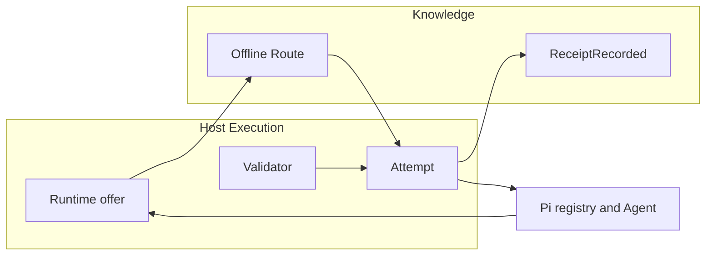
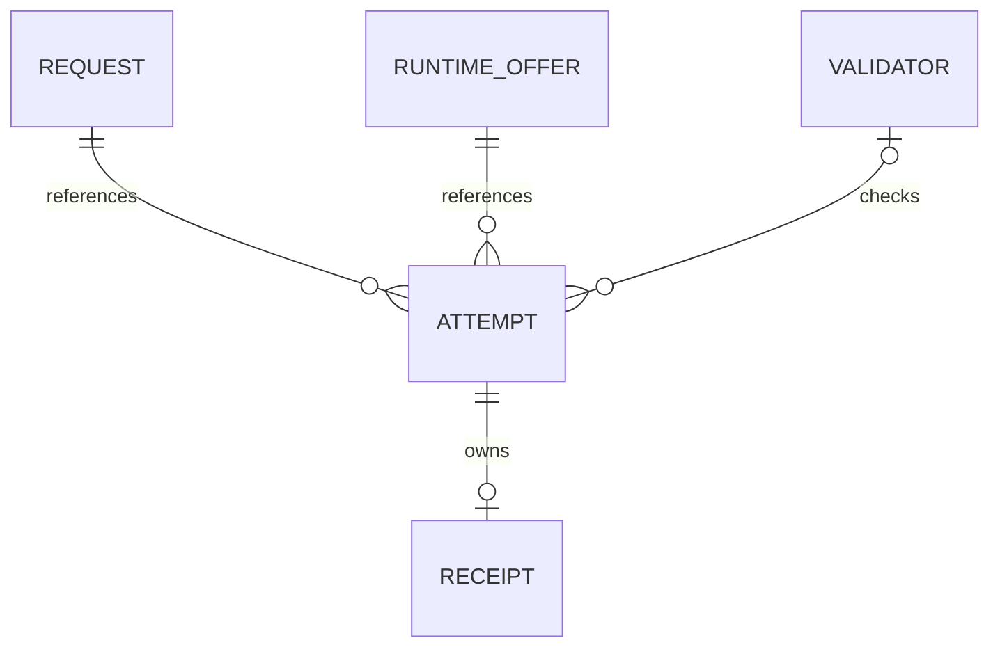
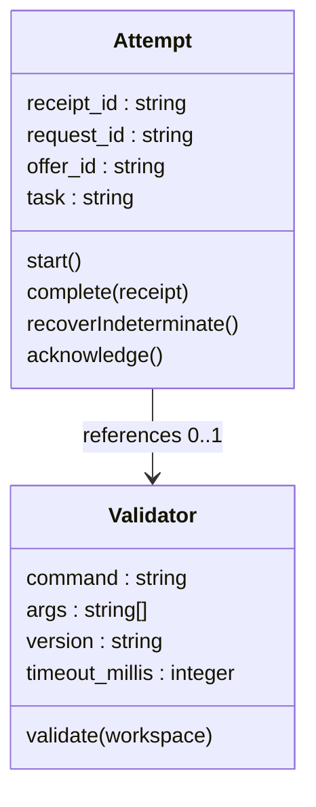
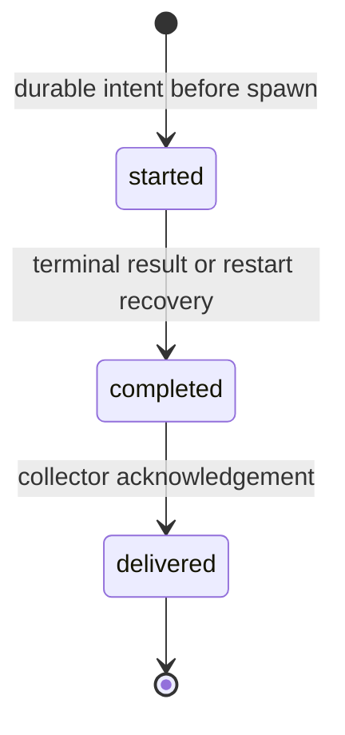

# Pi host adapter

Version 1, contract pass 3. User authorized this additional bounded repair after the second failed gate; implementation still requires PASS. Implementation contract for [host integration](host-integration.md), [CLI adapter](cli-adapter.md) and [ADR 0005](../adr/0005-mechanical-host-outcomes.md). Knowledge remains the core bounded context. Host Execution owns attempts, provider clients and validation. Pi registry and native subagent RPC types terminate at this adapter. No second router, model judge or service is introduced. This v1 specialization supersedes host-integration's image-execution verification and watcher requirement: images remain refused and one-shot reads observe the validated CURRENT pointer on every invocation.

## Caller classes and authority

- Model caller supplies task family, prompt, estimates and routing constraints. Cannot supply a selected model, receipt facts, usage or validation verdict.
- Local operator owns `agent-routing-host.json`, model entitlements and validator commands. Configuration is loaded from `PI_CODING_AGENT_DIR` or `~/.pi/agent`, never from tool arguments. Invalid configuration fails closed. This is an API-level provenance boundary, not a sandbox against tools with the same OS user identity: bash and write tools can modify operator files. Those tools and configured validator executables must be trusted; workspace checks can execute model-edited code and prove only their stated test scope.
- Native host supplies exact registry identities, current authentication and native spawn results. Credentials and native error bodies never enter routing documents or receipts.
- Collector receives closed receipts through `receipt record`. Authority, events and normalized Postgres tables remain those in [delivery storage](delivery-storage.md). Host spooling files are byte-exact delivery artifacts, not another database.

Operator config is the closed object `{cli, store, outbox, entitled_models, disabled_models, validators, native_package, route_timeout_millis, delivery_timeout_millis}`. `cli`, `store` and `outbox` are required absolute local paths, never URLs; defaults are absent, so unconfigured use fails closed. `entitled_models` is a required array of unique exact `provider/upstream_id` registry references; `disabled_models` defaults to `[]`. Neither creates registry entries. `validators` defaults to `{}` and maps Go task tokens to the closed Validator value below. `native_package` defaults to `<agentDir>/npm/node_modules/@tintinweb/pi-subagents`; require trusted installed package version `0.20.0` and RPC protocol 2, otherwise `host_unavailable`. Each timeout defaults to 30000 milliseconds and must be an integer in 1..300000. Validator timeout uses the same range. Unknown config members, invalid types, unsafe paths or unknown task keys are `invalid_config`. Config is read again for each routed attempt; selected entitlement/disable state is revalidated immediately before native spawn. Failed reload never falls back to an earlier permissive config. No DSN in config: collector submission uses the existing environment/config resolution, keeping credentials outside routing files.

## Objects and invariants

Runtime offer is an immutable value object with the fields and invariants of `RuntimeOfferData`. Read `getAvailableOfType("chat")` asynchronously, require successful request-time authentication and an exact operator entitlement entry and exclude explicitly disabled entries. Never fall back to `getAll()`. Entitlements filter registry entries; they cannot create candidates. Unknown remote entitlement fails eligibility until an operator assertion exists. Revalidate exact membership, entitlement and authentication immediately before native spawn. Local GPU providers require native resource admission not available in this adapter and are ineligible. Image-output and classifier targets are unsupported v1 operations, not simulated successes.

Capabilities derive only from native input modes and chat output. Unknown tools or structured-output capability stays absent. Context and output limits use the host's positive safe integers. Native pi costs are omitted: their provenance does not distinguish synthesized zero from a real quote and tier information cannot be silently flattened. Snapshot prices remain the sole pricing authority until an exact host price projection is qualified. Empty prices mean unknown. Generation encoding is exactly the sorting and hashing contract of host-integration, using JCS key ordering and bytewise `(provider, upstream_id)` tuple order. Integers, no nulls and nonempty arrays where required follow Go wire validation.

Attempt is a Host Execution entity, identified by a unique `receipt_id` generated once for each invocation. It references one request, one selected runtime offer and one task. Fields are `receipt_id`, `request_id`, `offer_id` and `task`; all nonempty, with closed task token. It owns one immutable completion receipt containing the existing seven usage components, outcome and validator version. Prompt, result text, native error bodies and credentials are excluded. Its legal transitions are new to started (durable intent), started to completed (host terminal result or recovered indeterminate receipt) and completed to delivered (collector acknowledgement). Reusing an attempt never spawns again. One attempt has exactly one receipt ID and at most one completion body; same ID with changed completion bytes is refused. Delivery failure does not delete evidence or undo execution.

Validator is an immutable operator configuration value: `command` (executable), `args` (string array), `version` (nonempty string) and `timeout_millis` (positive bounded integer). Config maps task token to zero or one validator. Model callers cannot select commands or supply versions. Host executes the configured command without a shell in the host workspace after a completed native attempt. Exit 0 means `validated_success`; a normal nonzero exit means `validated_failure`; spawn failure, timeout or interruption means `indeterminate`. Without a validator, normal provider completion remains `unvalidated_completion`. Provider failure remains `indeterminate`; abort or vanished registry entry is `cancelled`. Validator stdout and stderr are discarded. Mechanical checks establish only what that validator tests, not semantic success for arbitrary tasks. Jev and all model judges are v2 and disabled.

## API and handoff

Only model-facing operation is `routed_agent`. Request is `{prompt, description, task, mode, input_tokens, output_tokens, allow_unscored, minimum_estimate, max_turns, required_capabilities?, image_operation?, image_count?, image_width?, image_height?, image_bytes?, reference_count?, mask?, mask_alpha?, searches?, budget_known?, budget_micros?, strict_cost?, deadline_millis?, strict_latency?, max_age_seconds?, allowed_providers?, region?, privacy?}`. Required token estimates are nonnegative safe integers explicitly supplied by the caller; strict spend admission requires positive estimates rather than unknown-as-zero. Task, mode, capabilities and image operations use the Go closed vocabularies. Caller policy is passed unchanged. Images are not accepted through a text prompt; image requests are refused until native input attachment is implemented.

Authentication is the enclosing pi session. Authorization is host entitlement plus native spawn-tool availability. Behavior is one offline Route followed by `Attempt.start`, one native spawn, mechanical validation and `Attempt.complete`. No-admissible returns the complete unchanged decision as a failed tool result and never spawns. Invalid configuration, invalid request, unavailable snapshot, unavailable native spawner or unsupported operation fails before provider execution. No hidden fallback or model override exists.

Selected identity is resolved from the same registry read and revalidated before spawn. Use native `subagents:rpc:spawn`, not the model-facing `Agent` resolver: RPC options carry the exact registry Model object, `description`, positive `maxTurns` in 1..100, `isolated: true`, `inheritContext: false`, `isBackground: true` and the caller/deadline AbortSignal. This verified native RPC prioritizes explicit Model and maxTurns over agent-file defaults and avoids string/fuzzy resolution. `isolated` removes extension tools, skills and nested delegation. No worktree, resume or scheduling option is supplied. Native concurrency admission is retained. Register started/completed/failed listeners and the unique spawn-request reply listener before emitting the RPC. Every control RPC has a unique request ID and a one-shot reply deadline of `route_timeout_millis`; raw error envelopes never reach the caller. Bind the owned native ID from `onQueued(id)` or `onSpawned(id)` when called, otherwise from the successful reply; every later callback/reply must match that ID. `onSpawned` is after started, not before it. Buffer pre-binding events in memory by native ID with their host monotonic arrival times, then retain only the bound ID's facts and discard unrelated events. Never persist event bodies. The pinned implementation calls `onQueued` before a queued run can start and `onSpawned` before asynchronous provider completion, so owned terminal events are identifiable even before the RPC reply. Unknown or conflicting identities fail closed without another spawn. Wait only for this attempt, never poll or join unrelated agents. Package version and protocol must match before creating an intent; incompatible native implementations fail before provider execution. Native configuration must not replace the explicit Model or turn ceiling; integration tests prove conflicting agent-file defaults cannot change them.

While the adapter is loaded, model-issued `Agent`, `SubagentWorkflow`, `Workflow` and `steer_subagent` calls are blocked in `tool_call`. The only model-facing spawning path is `routed_agent`. Native operator UI, trusted extensions and preexisting scheduled jobs are outside this API-level gate; their work is neither claimed as routed nor recorded by the adapter. Spawned children are isolated and cannot delegate. The absolute deadline is `effective_at + deadline_millis`, or absent when the caller sets zero. Check cancellation before intent publication and again immediately before RPC emission. Before intent publication, cancellation returns the fixed `cancelled` API error without an attempt; after publication but before emission, complete a cancelled receipt without spawning. Forward cancellation to the exact native attempt using its AbortSignal and `subagents:rpc:stop` once its ID is bound. A cancellation arriving before binding is remembered and handled on binding, not ignored. Stop acknowledgement alone does not prove running work has terminated.

Evaluate missing started evidence only after ID binding and replay of the pre-binding buffer. For the pinned queued-abort path, a forwarded aborted signal with no correlated started event establishes that execution never started; settle it as cancelled without requiring a nonexistent terminal event. A spawn reply failure or timeout without a bound identity is indeterminate, never inferred cancelled. For an admitted attempt, await its terminal event for at most 5000 milliseconds after cancellation. If none arrives, freeze an indeterminate receipt with native usage unknown. First host settlement wins; later events cannot change receipt bytes or run a validator. Publish that frozen completion under the attempt lock, then release the lock so delivery can proceed; the lock protects host Attempt transitions, not remote work after an explicitly indeterminate settlement. Keep the owned notification listener until native terminal settlement or host shutdown and return the safe indeterminate tool result without waiting forever. At shutdown, forward cancellation, freeze any remaining intents as indeterminate and close lock-holder stdin after completion publication. Restart submits frozen completions without re-execution; process death also releases locks. These are one-shot cancellation deadlines, not periodic polling. No fallback spawn exists. Native spawning owns retry spend. The router admits against caller-supplied quantity estimates and qualified prices, not verified actual quantities; this adapter guarantees neither actual nor cumulative spend.

Tool response has text content and details `{request_id, receipt_id, decision, outcome, validator_version, delivery, timings, parent_usage_accounting}`. `delivery` is `pending` or `acknowledged`; receipt failure never hides successful execution. `timings` contains nonnegative `registry_millis` and `route_process_millis`. Optional `execution_millis` measures host wall time from native RPC emission to host outcome settlement, including queueing, native startup and validation when performed, excluding receipt delivery. Omit it when cancellation prevented RPC emission; absence means no native execution interval was measured. It is not proof of native termination after an indeterminate cancellation settlement. Optional `admission_millis` measures RPC emission to the correlated started-event arrival, including native admission and queue delay. Omit it if no started event was observed. True native session startup and provider-only latency are unavailable through this RPC and explicitly unmeasured; neither is reported as zero or renamed admission time. Successful native completion text may reach the caller but never persistence; failed native result/error content is replaced by fixed safe diagnostics. Known terminal statuses map as follows: `completed` runs the configured validator or becomes `unvalidated_completion`; `aborted` or `stopped` is `cancelled`; `error`, missing/unknown status or incomplete terminal evidence is `indeterminate`. `steered` is not fully completed and remains `indeterminate`. A native refusal without a mechanical check is never validated success. Recovering an abandoned intent records all seven usage components unknown and empty validator version. Elapsed time on a live attempt is host-measured and known.

Owned completed/failed handlers synchronously emit `subagents:rpc:consume` with a unique request ID and the owned agent ID before any validation, persistence or delivery await. This marks the native record consumed before its automatic notification check, preventing raw native result/error notifications from reaching the model independently of the safe wrapper result. `onQueued`/`onSpawned` binding precedes terminal notification in the pinned supported paths; tests must prove this ordering, including queued startup failure. Consume only owned IDs. Retain the handler for late terminals after cancellation settlement and consume them without changing the frozen receipt. Native append-only session entries are outside routing and receipt storage; this adapter does not claim to sanitize native internal history. An incompatible notification/consume integration is `host_unavailable`, not a permissive fallback.

Correlated terminal events supply per-attempt native usage when present. Input-token usage includes native input, cache-read and cache-write token counts; output uses the native output count. Accept only safe nonnegative integers whose sums remain safe; absent or unqualified zero counts remain unknown. Image, reference and search usage is unknown in this v1 text-only path. Host-measured elapsed time from intent publication to first host outcome settlement is known for live attempts; recovered attempts have unknown elapsed time. Formatted totals and the shared pending usage pool are never parsed. Receipts record these facts independently of parent accounting.

Parent session accounting is incomplete for this RPC wrapper. When native subagent usage reporting is enabled, spend accumulates in `PendingUsagePool`, but `routed_agent` is not wrapped in reporting and cannot safely drain the private shared pool. When native reporting is disabled, no such drain can account it. Do not attach event usage to the wrapper's tool result: a later native reporting-tool drain could double count it. Tool details include `parent_usage_accounting: "not_integrated"` and a fixed disclosure that the pi parent footer/cost view may omit routed spend. No complete parent cost accounting is claimed and no fabricated native-tool invocation is used solely to drain usage.

`routed_agent` errors are fixed codes: `invalid_config`, `invalid_request`, `host_unavailable`, `snapshot_unavailable`, `no_admissible_offer`, `unsupported_operation`, `delivery_unavailable` and `cancelled`. Invalid/missing snapshots fail safely; no-admissible details retain the full unchanged Decision. API preflight errors do not spawn or create an attempt. They return fixed safe text with details `{error: {code}, decision?}`; `decision` is present only for `no_admissible_offer` and is unchanged. After `Attempt.start`, failures settle the existing attempt and return its completion shape, preserving request/receipt identity. That shape may include `{error: {code}}` for an operational failure; absence means no operational error. Validation failure remains an outcome, not a fabricated transport error.

`receipt record` receives the stable canonical completion document. Retry is idempotent by receipt ID and identical bytes. It is not safe to retry `routed_agent` as another execution: each accepted tool invocation is a new attempt. No model-callable receipt-write operation exists.

## Process and artifact boundaries

Use one bounded subprocess implementation for route, record and validators. Write request bytes to stdin and close it; cap output and wall time, terminate on caller cancellation and suppress raw child-process errors. Route requests carry exactly one trailing LF. Exit 0 and 3 parse stdout as a complete decision; exit 3 is not a transport failure. Never expose raw command lines, stdout diagnostics or stderr on errors. Collector DSN is passed through `AGENT_ROUTING_DSN`, never argv. No DSN is written to attempt or receipt files.

Read store CURRENT on every route, resolve only a lowercase 64-hex snapshot name and let Go check every artifact. Collector adoption remains the authoritative validated atomic pointer update. No duplicate watcher or cached stale pointer is required for a one-shot reader. Failed adoption retains the prior pointer. Local publication and adopted artifact hash are reported with the unchanged decision.

## Durable delivery and events

Attempt directory is private mode 0700; immutable intent and completion files are mode 0600. Publish by write and file fsync, then atomic no-replace link and directory fsync. Intent stores only the four Attempt fields. Completion stores only the closed receipt document. Refuse unsafe IDs and symlink escapes. Matching existing bytes are idempotent; differing bytes conflict. Hold a crash-released per-attempt OS advisory lock from before intent publication through host execution, validation and immutable completion publication. A frozen indeterminate cancellation completion ends the host Attempt even if native cessation is unconfirmed; later native events cannot write another completion. Recovery and delivery must acquire the same nonblocking lock; a live owner's locked attempt is skipped, never classified as abandoned. OS lock files are excluded from intent/completion enumeration and can remain empty indefinitely without becoming work. A lock-holder subprocess owns the kernel lock, keeps stdin open and releases on EOF or process death. No PID inference, stale-clock lease or heartbeat decides whether an attempt is alive.

Expose this existing-native-primitive boundary as `agent-routing receipt lock --path PATH`: authenticated local OS user supplies an absolute lock path inside the private outbox; command opens without following a final symlink, acquires exclusive nonblocking `flock`, emits canonical `{locked:true}` plus one LF and holds until stdin EOF. It performs no network, clock or database operation. Exit 0 on released ownership, 2 on invalid arguments, 4 with safe `lock_busy` or `lock_unavailable` on acquisition failure and 5 on unexpected failure. Lock acquisition has no domain event/table because it protects host transport files, not Knowledge authority. Command must use the existing native Go syscall dependency, not a new lock service.

After collector acknowledgement, unlink and fsync the intent first, then unlink and fsync completion. This order prevents an interrupted cleanup from resurrecting an acknowledged intent. Duplicate submitters acquire the same lock; interrupted acknowledgements retry identical receipt bytes and rely on collector idempotency.

At `session_start`, acquire each available intent's lock and reconcile incomplete intents as indeterminate without re-executing prompts, then submit pending completions. Submission reacts to completion publication and session restart. Transient submission failures arrange exponential-backoff retry deadlines, bounded at 60 seconds; no periodic empty polling. Attempt files survive shutdown and machine restart. One failure never aborts other submissions. Error diagnostics contain only fixed codes and receipt identifiers. Receipt conflicts remain retained and visibly blocked, not overwritten or dropped.

Host lifecycle notifications are internal, not new public domain events: durable `AttemptStarted` is the intent publication; `AttemptCompleted` is completion publication; `ReceiptAcknowledged` follows collector acknowledgement. Their payloads are the immutable files above, their sole consumer is the delivery reconciler and replay is at least once by stable receipt ID. Cross-context publication remains existing `ReceiptRecorded` from the collector. No new tables, migrations or aggregate transitions in Knowledge are introduced. Local files are an outbox transport exception with byte fidelity, not relational authority.

## Verification

Cross-language fixtures run TypeScript encoding through the real built Go CLI and compare accepted request bytes, generation hash and decisions. Regressions cover child stdin closure, timeout and abort, invalid task/mode/image/outcome vocabulary, unknown prices, no-admissible full rejections, tuple sorting, UTF-16 JCS keys, entitlement revocation and empty credential sets. Host-path tests drive native nested tool execution, block direct Agent bypass, derive receipts from measured execution and a real validator, reject model-supplied verdicts and restore pending delivery after lost acknowledgement or restart. Native boundary regressions cover started before `onSpawned`, completion before spawn reply, queued startup failure, already-aborted queued spawn with no terminal event, cancellation during admission and a running attempt that never emits a terminal event. Prove first-settlement receipt immutability, delivery of an indeterminate cancellation without waiting for unconfirmed native termination, shutdown lock release and synchronous consume before deliberately delayed validation suppressing credential-bearing native notifications. Prove unrelated notifications remain untouched. Verify `admission_millis` is never labeled startup, true startup remains unmeasured and `parent_usage_accounting` discloses deferred reporting without event usage attached to the wrapper or later double counting. Real Postgres receipt replay and same-ID conflict tests remain mandatory. Build and default monorepo tests must include this package. Actual paid-provider work is existing authorized implementation only, never an extra evaluation campaign.
